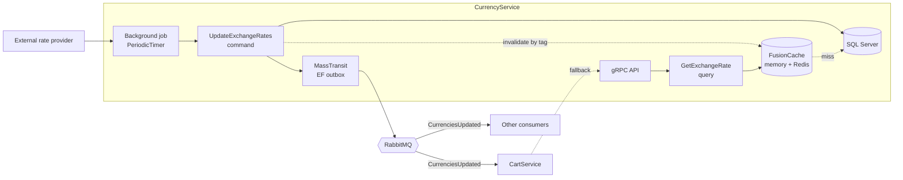
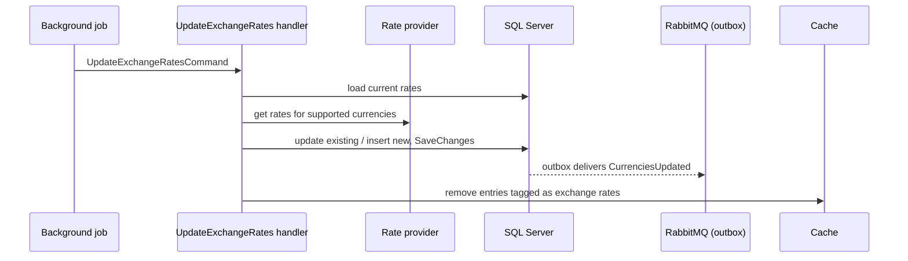

# CurrencyService

Exchange-rate microservice of **MigApp**, an e-commerce marketplace platform built on microservices and CQRS.

CurrencyService is the single source of truth for exchange rates in the platform. It pulls rates from an external provider on a schedule, stores the latest rate per supported currency, answers rate queries over gRPC and pushes every update to other services as an integration event.

## Contents

- [Responsibilities](#responsibilities)
- [Architecture](#architecture)
- [Tech stack](#tech-stack)
- [Solution layout](#solution-layout)
- [Domain model](#domain-model)
- [How it works](#how-it-works)
- [gRPC API](#grpc-api)
- [Integration events](#integration-events)
- [Persistence](#persistence)
- [Caching](#caching)
- [Observability and health](#observability-and-health)
- [Getting started](#getting-started)
- [Design decisions](#design-decisions)
- [Known limitations and roadmap](#known-limitations-and-roadmap)

## Responsibilities

| CurrencyService does | CurrencyService does not |
|---|---|
| Fetch rates from an external provider every few minutes | Convert prices or amounts (consumers do the arithmetic) |
| Store the latest rate for every supported currency | Store rate history |
| Return the cross rate between any two supported currencies | Decide which currency a buyer sees |
| Publish all rates to the platform after each successful update | Hold prices, carts or orders |
| Report update freshness and missing rates as metrics | |

## Architecture



The service follows Clean Architecture with CQRS. Commands change state through the domain model and EF Core. Queries are read-only and go through the cache first.

## Tech stack

| Area | Technology |
|---|---|
| Runtime | .NET (see `global.json` / `TargetFramework`) |
| API | gRPC with gRPC health checks |
| CQRS | MediatR with validation and tracing pipeline behaviours |
| Storage | EF Core, SQL Server |
| Messaging | MassTransit over RabbitMQ with the EF Core bus outbox |
| Cache | FusionCache (memory, Redis, Redis backplane) with fail-safe |
| Provider client | Typed `HttpClient` with the standard resilience handler (retries, timeouts, circuit breaker) |
| Observability | OpenTelemetry (traces, metrics), Serilog (JSON logs) |
| Errors | `Result` pattern with error codes |
| Shared code | `migApp.Shared` (results, value objects, behaviours, caching, gRPC helpers, integration events) |

## Solution layout

```text
CurrencyService
├── CurrencyService.Domain           ExchangeRate model, domain errors
├── CurrencyService.Application      Commands, queries, interfaces, cache keys and tags
├── CurrencyService.Infrastructure   EF Core, provider client, background job, messaging,
│                                    cache, observability, DI
└── CurrencyService.Api              gRPC service, Program.cs
```

Dependencies point inwards: `Api → Application → Domain`, and `Infrastructure → Application`.

## Domain model

`ExchangeRate` holds the current rate of one currency:

| Property | Meaning |
|---|---|
| `Currency` | One of the supported currencies |
| `Rate` | Units of that currency per **1 USD** (the base currency) |
| `UpdatedAt` | When the rate was last refreshed |

- The **base currency is USD**. Every stored rate is relative to it.
- A rate must be greater than zero. Both `Create` and `Update` reject anything else.
- The set of supported currencies is closed and declared in `Currency.All` in the shared library. Rates from the provider for any other currency are ignored.

## How it works

### Update flow



1. A hosted service runs the update once at start-up and then on a `PeriodicTimer` with a configurable interval.
2. The handler loads the stored rates, asks the provider for all supported currencies, then updates existing rows and inserts missing ones.
3. A `CurrenciesUpdatedIntegrationEvent` is published through the **EF outbox**, so the event is saved in the same transaction as the rates and is never lost or sent for rates that were not saved.
4. Cached rates are invalidated by tag.
5. Metrics record how many rates were updated, when the last successful update happened and which expected currencies the provider did not return.

A failed run is logged and does not stop the service. The next tick tries again. Cancellation during host shutdown is not treated as an error.

### Query flow

`GetExchangeRate(from, to)` validates both codes, returns `1` when they are the same, otherwise reads both rates (cache first, database on a miss) and returns the cross rate:

```text
rate(from → to) = rate(to) / rate(from)
```

Both rates are per 1 USD, so this works for any pair, not only pairs that include USD. Converted amount = amount in `from` × the returned rate. If either currency has no stored rate, the query fails with a `NotFound` error.

## gRPC API

Service implementation: `GrpcServer` in `CurrencyService.Api.Grpc.V1`. Business failures are returned as `Result` errors with stable codes and translated to gRPC status codes by a server interceptor.

| RPC | Purpose |
|---|---|
| `GetExchangeRate` | Return the rate to convert from one currency code to another |

Errors you should handle: invalid code format, unsupported currency, rate not found.

The standard gRPC health service is mapped as well (see [Observability and health](#observability-and-health)).

## Integration events

| Event | Direction | Payload |
|---|---|---|
| `CurrenciesUpdatedIntegrationEvent` | Published | Dictionary of currency code → rate per 1 USD |

Consumers such as CartService keep these rates in their own cache. If their cache is empty they fall back to `GetExchangeRate` over gRPC.

## Persistence

SQL Server. The EF migrations history table lives in the `ExchangeRates` schema.

| Table | Notes |
|---|---|
| `ExchangeRates` | One row per currency: currency, rate, last update time |
| MassTransit outbox tables | Outbox messages and state for reliable publishing |

Only the latest rate per currency is stored.

Migrations are applied manually (automatic migration at start-up is disabled in `Program.cs`).

## Caching

FusionCache under the name `currency`:

- **L1:** in memory. **L2:** Redis. **Backplane:** Redis, so instances invalidate each other.
- Rates are cached **per currency**, not per pair. Any pair is derived from two cached entries.
- All rate entries carry one tag. The update command removes them all by tag after a successful run.
- **Fail-safe** keeps serving a stale rate for up to 24 hours if the database is unavailable, with a short throttle before the next attempt. Factory soft and hard timeouts keep slow reads from piling up.
- The cache has its own name so backplane channels do not collide with other services that share the same Redis.

## Observability and health

- **Traces:** ASP.NET Core, HTTP client (including provider calls), FusionCache, MassTransit and a custom `CurrencyService` source.
- **Metrics:** ASP.NET Core, HTTP client, FusionCache, runtime, plus `CurrencyServiceMetrics`: rates updated, last successful update time, missing rate per currency.
- **Exporter:** OTLP for both traces and metrics.
- **Logs:** Serilog, JSON to the console and OTLP, enriched with service name, machine name and thread id.
- **Health checks (gRPC health service):** `self`, SQL Server, RabbitMQ and Redis, the last three tagged `ready`.

A useful alert: the last successful update is older than a few update intervals.

## Getting started

### Prerequisites

- .NET SDK (version from the repository's `global.json` or project files)
- SQL Server, Redis and RabbitMQ (use the Compose file below for local development)
- Access to the rate provider's API

### Local infrastructure

```yaml
# docker-compose.yml (example for local development only)
services:
  sqlserver:
    image: mcr.microsoft.com/mssql/server:2022-latest
    environment:
      ACCEPT_EULA: "Y"
      MSSQL_SA_PASSWORD: "<strong-password>"
    ports: ["1433:1433"]

  redis:
    image: redis:7
    ports: ["6379:6379"]

  rabbitmq:
    image: rabbitmq:3-management
    ports: ["5672:5672", "15672:15672"]
```

### Configuration

Use user secrets or environment variables for anything sensitive.

```json
{
  "ConnectionStrings": {
    "Database": "Server=localhost,1433;Database=CurrencyService;User Id=sa;Password=<strong-password>;TrustServerCertificate=True",
    "Redis": "localhost:6379",
    "OtlpEndpoint": "http://localhost:4317"
  },
  "RabbitMQ": {
    "Host": "localhost",
    "Port": 5672,
    "VirtualHost": "/",
    "Username": "<username>",
    "Password": "<password>"
  },
  "ExchangeRateApi": {
    "BaseUrl": "<provider base url>"
  },
  "UpdateExchangeRates": {
    "Interval": "00:10:00"
  }
}
```

`Interval` is the update period (ten minutes here as an example). It must be greater than zero. The service validates this and the RabbitMQ settings at start-up and refuses to start with a clear message if something is missing. It also requires `ExchangeRateApi:BaseUrl`, the database, Redis and OTLP settings.

### Run

```bash
# apply migrations
dotnet ef database update \
  --project src/CurrencyService.Infrastructure \
  --startup-project src/CurrencyService.Api

# start the service
dotnet run --project src/CurrencyService.Api
```

Adjust the project paths to match the repository layout.

### Tests

```bash
dotnet test
```

## Design decisions

**One base currency (USD), cross rates computed on read.** Storing one rate per currency instead of every pair keeps the table small and the update atomic. Any pair is `rate(to) / rate(from)`, so adding a currency adds one row, not a new row for each existing currency.

**Push first, pull as a fallback.** After each update the service publishes all rates, so consumers hold fresh rates locally and read them without a network call. The gRPC query exists for the case when a consumer's cache is empty or an event was missed.

**Outbox for the event.** The rates and the event commit together. Consumers never see an event for rates that were not saved.

**Cache per currency with one tag.** Two entries serve every pair, and a single tag removes all of them after an update.

**Fail-safe everywhere it matters.** The provider client has retries and a circuit breaker, and the cache serves stale rates for a day if the database is down. A short outage of either side does not break the platform's price display.

**Scheduled in-process job.** A `PeriodicTimer` inside the service is simple and testable with a fake `TimeProvider`. A failed run only logs and waits for the next tick.

**Freshness is observable.** The last successful update time and the missing-rate counter make a stale or incomplete update visible in dashboards and alerts.

## Related services

| Service | Relationship |
|---|---|
| CartService | Consumes `CurrenciesUpdated`, falls back to `GetExchangeRate` over gRPC, converts prices for display only |
| Other services | May consume the same event or call the gRPC API when they need to show amounts in a buyer's currency |
